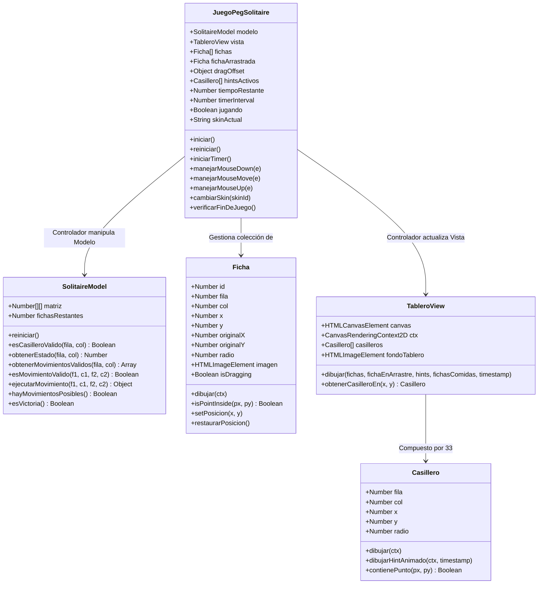

# Plan Maestro y Especificación Técnica — Videojuego PEG SOLITAIRE (Entregable Nº 4)

> **Materia:** Diseño de Interfaces / Interfaces de Usuario e Interacción (TUDAI / UNCPBA)  
> **Alumno:** Aitor Holzmann  
> **Fecha Límite:** 04/11/2026 a las 23:59:59 hs — Branch `gh-pages`  
> **Arquitectura:** Patrón MVC Estricto (Modelo-Vista-Controlador), Canvas 2D nativo, Drag & Drop interactivo con Hit-Testing radial y Hints animados.  
> **Destinatario:** Este documento contiene la especificación completa, exhaustiva y autosuficiente para que cualquier agente o desarrollador ejecute la implementación **one-shot** sin requerir decisiones de diseño adicionales.

---

## 1. Reglas de Negocio y Consignas de la Cátedra

1. **Tablero con imagen de fondo:** Fondo temático que represente el tablero clásico de Peg Solitaire (cruz inglesa de 33 casilleros).
2. **Fichas con imágenes temáticas (Cero colores planos):** Fichas renderizadas con `ctx.drawImage` a partir de imágenes temáticas (militar/táctica, acorde al portal: medallas, granadas, insignias).
3. **Mecánica Drag and Drop nativa en Canvas:**
   - Selección mediante `mousedown`, arrastre con `mousemove` y caída/soltado con `mouseup`.
   - **Hints animados obligatorios:** Al seleccionar o arrastrar una ficha, se deben iluminar y animar en tiempo real los casilleros legales de destino (aro pulsante con función sinusoidal periódica y flecha indicadora).
4. **Lógica matemática de Peg Solitaire:**
   - Salto ortogonal (arriba, abajo, izquierda, derecha; prohibidas diagonales).
   - Distancia de salto: exactamente 2 casilleros sobre una ficha intermedia adyacente hacia un casillero vacío.
   - Eliminación de la ficha intermedia sobre la que se saltó.
5. **Detección automática de fin de partida:**
   - Evaluado tras cada movimiento válido.
   - **Victoria:** Queda exactamente 1 sola ficha en el tablero (idealmente en el centro).
   - **Derrota / Game Over:** No quedan saltos posibles en todo el tablero y hay más de 1 ficha, o se agota el tiempo límite.
6. **Mecánica de retorno ante soltado inválido:**
   - Si la ficha se suelta en un lugar inválido, retorna inmediatamente a su coordenada original `(originalX, originalY)` sin saltos ni jugadas accidentales.
7. **Timer con límite y botón de reinicio:**
   - Cuenta regresiva desde 03:00 (180 segundos). Al llegar a 00:00 se declara derrota por tiempo.
   - Botón visible para reiniciar la partida en cualquier momento.
8. **Selector de Skins (Tipos de Fichas):**
   - Permitir cambiar entre al menos 3 diseños visuales de fichas en tiempo real (Medallas Militares, Granadas Tácticas, Insignias de Rango).
9. **Integración web estricta:**
   - Sala de juego alojada exclusivamente en `pegsolitaire.html`.
   - Canvas Full HD sin scroll (`width: 800px; height: 500px` nativo).
10. **Comentarios pedagógicos para coloquio:** Todos los métodos deben tener comentarios en español explicando qué hacen y por qué.

---

## 2. Lecciones Arquitectónicas del TP3 Aplicadas al TP4

Durante el análisis del código real de `js/blocka/` y `css/game.css` se identificaron 5 principios obligatorios:

1. **Resolución de Canvas en $800 \times 500$:**  
   El contenedor `#game-splash-pantalla canvas` tiene en CSS un tamaño fijo de $800 \times 500\text{ px}$.  
   - Si creamos un canvas de $600 \times 600$, el CSS lo aplasta forzándolo a $800 \times 500$, transformando los círculos en elipses horizontales y **rompiendo el cálculo de distancia euclidiana**.
   - **Solución implementada:** El canvas nativo será de $800 \times 500\text{ px}$. La grilla simétrica de $7 \times 7$ se renderiza centrada en un cuadrado de $434 \times 434\text{ px}$ usando `offsetX = 183` y `offsetY = 33`. Las franjas laterales de $183\text{ px}$ se utilizan para el panel de bajas (fichas comidas que se van apilando estéticamente) y el HUD de estado.
2. **Separación de Hit-Testing (Agarre vs Soltado):**
   - **Agarre (`mousedown`):** Lo resuelve la clase `Ficha` con distancia euclidiana entre el cursor y su centro: $\sqrt{\Delta x^2 + \Delta y^2} \le radio$.
   - **Soltado (`mouseup`):** Lo resuelve la clase `Casillero` evaluando si el centro de la ficha soltada cayó dentro del radio de atracción del casillero destino legal: $\sqrt{\Delta x^2 + \Delta y^2} \le radio \times 1.2$.
3. **Celdas Estrictamente Cuadradas:**
   - Separación idéntica horizontal y vertical entre centros: `pasoX === pasoY === 62px`.
4. **Transiciones CSS Unificadas:**
   - **Regla estricta:** En cualquier declaración `transition`, utilizar **el mismo tiempo y función de aceleración para todas las propiedades**. Prohibido usar `0.3s` para opacity y `0.2s` para transform. Usar siempre un único valor uniforme, ej: `transition: opacity 0.25s ease, transform 0.25s ease;` o `transition: all 0.25s ease;`.
5. **Hooks de Testeo por URL Hash (`#test-...`):**
   - Implementar en el controlador la lectura de `window.location.hash` para pruebas visuales automáticas inmediatas sin jugar manualmente.

---

## 3. Arquitectura de Archivos y Responsabilidades

```text
/
├── pegsolitaire.html                   # Sala de juego: Canvas 800x500, HUD, modal y scripts
├── Plantp4.md                          # Este documento (plan maestro)
├── css/
│   ├── variables.css                   # Tokens de colores y radios
│   ├── game.css                        # Estilos de HUD, selector de skins, modal de fin y canvas
│   └── ...
├── js/
│   ├── api.js                          # (existente)
│   ├── main.js                         # (existente)
│   └── pegsolitaire/                   # Módulo autocontenido MVC
│       ├── configuracion.js            # Constantes, grilla 7x7, skins, tiempos y estados
│       ├── SolitaireModel.js           # MODELO: Lógica matemática 7x7 pura (sin DOM ni Canvas)
│       ├── Ficha.js                    # ENTIDAD: Coordenadas, imagen, arrastre y hit-testing de agarre
│       ├── Casillero.js                # ENTIDAD: Coordenadas fijas, hit-testing de caída y hint animado
│       ├── TableroView.js              # VISTA: Renderizado por capas (fondo, ranuras, hints, fichas, bajas)
│       └── pegsolitaire.js             # CONTROLADOR: Eventos mouse, loop rAF, timer, HUD, modal y tests
└── assets/
    └── images/
        └── pegsolitaire/               # Banco de recursos gráficos
            ├── tablero-bg.png          # Textura/fondo del tablero circular
            ├── ficha-medalla.png       # Skin 1: Medalla militar dorada
            ├── ficha-granada.png       # Skin 2: Granada táctica
            └── ficha-insignia.png      # Skin 3: Insignia de rango táctico
```

### Orden de carga en `pegsolitaire.html`

```html
<!-- PEG SOLITAIRE — Módulo MVC (Scripts Clásicos) -->
<script src="js/pegsolitaire/configuracion.js"></script>
<script src="js/pegsolitaire/SolitaireModel.js"></script>
<script src="js/pegsolitaire/Ficha.js"></script>
<script src="js/pegsolitaire/Casillero.js"></script>
<script src="js/pegsolitaire/TableroView.js"></script>
<script src="js/pegsolitaire/pegsolitaire.js"></script>
```

---

## 4. Diagrama de Clases (Patrón MVC)



---

## 5. Especificación Técnica Módulo por Módulo

### 5.1. `configuracion.js`
- **Dimensiones:**
  ```javascript
  const CANVAS_ANCHO = 800;
  const CANVAS_ALTO = 500;
  const TAMANO_GRILLA = 7;
  const PASO_CELDA = 62; // Distancia entre centros
  const RADIO_FICHA = 24;
  const RADIO_CASILLERO = 22;
  const OFFSET_X = Math.floor((CANVAS_ANCHO - (TAMANO_GRILLA * PASO_CELDA)) / 2); // 183px
  const OFFSET_Y = Math.floor((CANVAS_ALTO - (TAMANO_GRILLA * PASO_CELDA)) / 2);  // 33px
  ```
- **Estados Lógicos del Casillero:**
  ```javascript
  const ESTADO = {
    BLOQUEADO: -1, // Esquinas fuera de la cruz
    VACIO: 0,      // Hueco disponible para saltar
    FICHA: 1       // Ocupado por una ficha activa
  };
  ```
- **Matriz Inicial del Tablero Inglés ($7 \times 7$ con 33 casilleros y centro vacío):**
  ```javascript
  const TABLERO_INICIAL = [
    [-1, -1,  1,  1,  1, -1, -1],
    [-1, -1,  1,  1,  1, -1, -1],
    [ 1,  1,  1,  1,  1,  1,  1],
    [ 1,  1,  1,  0,  1,  1,  1], // Centro (3,3) vacío
    [ 1,  1,  1,  1,  1,  1,  1],
    [-1, -1,  1,  1,  1, -1, -1],
    [-1, -1,  1,  1,  1, -1, -1]
  ];
  ```
- **Skins Disponibles:**
  ```javascript
  const SKINS_FICHAS = {
    medalla: { id: 'medalla', nombre: 'Medallas Militares', src: 'assets/images/pegsolitaire/ficha-medalla.png' },
    granada: { id: 'granada', nombre: 'Granadas Tácticas', src: 'assets/images/pegsolitaire/ficha-granada.png' },
    insignia: { id: 'insignia', nombre: 'Insignias de Rango', src: 'assets/images/pegsolitaire/ficha-insignia.png' }
  };
  ```

---

### 5.2. `SolitaireModel.js` (Modelo Matemático Puro)
- **Atributos:**
  - `this.matriz`: Clon profundo de `TABLERO_INICIAL`.
  - `this.fichasRestantes`: Inicia en `32`.
- **Métodos:**
  - `reiniciar()`: Restaura la matriz a su estado inicial y resetea `fichasRestantes = 32`.
  - `esCasilleroValido(f, c)`: Retorna `true` si $0 \le f, c < 7$ y `matriz[f][c] !== -1`.
  - `obtenerEstado(f, c)`: Retorna el estado numérico (`-1`, `0`, `1`).
  - `obtenerMovimientosValidos(f, c)`:  
    Si `matriz[f][c] !== 1`, retorna `[]`.  
    Evalúa las 4 direcciones cardinales $(\Delta f, \Delta c) \in \{(-2,0), (2,0), (0,-2), (0,2)\}$:
    - Casillero destino $(f + \Delta f, c + \Delta c)$ debe ser válido y tener estado `0` (vacío).
    - Casillero intermedio $(f + \Delta f/2, c + \Delta c/2)$ debe tener estado `1` (ficha a comer).
    - Retorna arreglo de objetos: `[{ destFila, destCol, saltadaFila, saltadaCol }]`.
  - `esMovimientoValido(f1, c1, f2, c2)`: Verifica si `(f2, c2)` está en la lista de movimientos válidos de `(f1, c1)`.
  - `ejecutarMovimiento(f1, c1, f2, c2)`:  
    - Calcula la celda intermedia: $f_{mid} = (f1 + f2)/2, c_{mid} = (c1 + c2)/2$.
    - `matriz[f1][c1] = 0;`
    - `matriz[fmid][cmid] = 0;`
    - `matriz[f2][c2] = 1;`
    - `fichasRestantes--;`
    - Retorna `{ saltadaFila: fmid, saltadaCol: cmid }`.
  - `hayMovimientosPosibles()`:  
    Itera por las 33 posiciones válidas. Para toda casilla con valor `1`, invoca `obtenerMovimientosValidos(f, c)`. Si alguna tiene longitud $> 0$, retorna inmediatamente `true`. Si termina el bucle sin movimientos, retorna `false`.
  - `esVictoria()`: Retorna `this.fichasRestantes === 1`.

---

### 5.3. `Ficha.js` (Entidad Gráfica)
- **Atributos:** `id, fila, col, x, y, originalX, originalY, radio, imagen, isDragging`.
- **Hit-Testing Radial (Filmina 10 del Tema 4):**
  ```javascript
  isPointInside(px, py) {
    var dx = this.x - px;
    var dy = this.y - py;
    return Math.sqrt(dx * dx + dy * dy) <= this.radio;
  }
  ```
- **Dibujado (`dibujar(ctx)`):**
  - Si `isDragging`: proyecta sombra suave (`ctx.shadowColor = 'rgba(0,0,0,0.6)'; ctx.shadowBlur = 12; ctx.shadowOffsetY = 6;`).
  - Dibuja la imagen recortada en círculo con `ctx.save()`, `ctx.beginPath()`, `ctx.arc(...)`, `ctx.clip()`, `ctx.drawImage(...)`, `ctx.restore()`.
  - Borde metálico exterior con `ctx.stroke()`.
- **Gestión de Posición:**
  - `setPosicion(x, y)`: Actualiza `this.x = x; this.y = y;`.
  - `fijarEnCasillero(f, c, x, y)`: Actualiza `this.fila = f; this.col = c; this.x = x; this.y = y; this.originalX = x; this.originalY = y;`.
  - `restaurarPosicion()`: Vuelve a `this.x = this.originalX; this.y = this.originalY;`.

---

### 5.4. `Casillero.js` (Entidad Hueco / Receptor)
- **Atributos:** `fila, col, x, y, radio`.
- **Hit-Testing de Caída:**
  ```javascript
  contienePunto(px, py) {
    var dx = this.x - px;
    var dy = this.y - py;
    // Rango de atracción con 20% de tolerancia para soltado fluido
    return Math.sqrt(dx * dx + dy * dy) <= (this.radio * 1.25);
  }
  ```
- **Dibujado Normal (`dibujar(ctx)`):**
  - Hueco biselado oscuro con gradiente radial simétrico simulando profundidad en el tablero.
- **Hint Animado Obligatorio (`dibujarHintAnimado(ctx, timestamp)`):**
  - **Aro pulsante sinusoidal:**
    ```javascript
    var oscilacion = Math.sin(timestamp * 0.006) * 4;
    var radioHint = this.radio + oscilacion;
    ctx.save();
    ctx.beginPath();
    ctx.arc(this.x, this.y, radioHint, 0, Math.PI * 2);
    ctx.strokeStyle = 'rgba(255, 170, 0, 0.9)'; // Ámbar táctico de alta visibilidad
    ctx.lineWidth = 3.5;
    ctx.shadowColor = '#FFAA00';
    ctx.shadowBlur = 10;
    ctx.stroke();
    ctx.restore();
    ```
  - **Flecha indicadora flotante:**
    ```javascript
    var desfasajeY = Math.sin(timestamp * 0.008) * 5;
    var flechaY = this.y - this.radio - 10 + desfasajeY;
    ctx.save();
    ctx.fillStyle = '#FFAA00';
    ctx.beginPath();
    ctx.moveTo(this.x, flechaY + 8);
    ctx.lineTo(this.x - 6, flechaY);
    ctx.lineTo(this.x + 6, flechaY);
    ctx.closePath();
    ctx.fill();
    ctx.restore();
    ```

---

### 5.5. `TableroView.js` (Gestor de Capas del Canvas)
- **Atributos:** `canvas, ctx, casilleros (array 33), fondoTablero (HTMLImageElement)`.
- **Ciclo de Dibujado por Capas (`redraw`):**
  1. **Capa 0 (Limpieza y Fondo General):** Limpia con `ctx.clearRect(0, 0, 800, 500)` y dibuja fondo oscuro texturado.
  2. **Capa 1 (Base del Tablero Centrado):** Dibuja el tablero circular de madera/metal en `(CANVAS_ANCHO/2, CANVAS_ALTO/2)` con radio $\approx 220\text{px}$.
  3. **Capa 2 (Casilleros / Huecos):** Itera y dibuja los 33 casilleros fijos.
  4. **Capa 3 (Hints Animados Activos):** Si hay casilleros marcados como legales para la ficha en arrastre, ejecuta `dibujarHintAnimado` en cada uno.
  5. **Capa 4 (Fichas Estáticas):** Dibuja todas las fichas en juego que **no** estén siendo arrastradas.
  6. **Capa 5 (Z-Index Superior):** Si hay una ficha arrastrada, se dibuja en último lugar para que flote por encima de todas las demás piezas y ranuras.
  7. **Capa 6 (Cementerio de Bajas Lateral):** En el lateral izquierdo (`x < 160`), dibuja en columna o cuadrícula miniatura las fichas eliminadas para reforzar el feedback de progreso militar.

---

### 5.6. `pegsolitaire.js` (Controlador y Orquestador)
- **Máquina de Estados de Mouse:**
  - `mousedown`:
    - Convierte `(e.clientX, e.clientY)` a coordenadas de Canvas con `getBoundingClientRect()`.
    - Busca ficha con `ficha.isPointInside(mx, my)`.
    - Si encuentra una ficha:
      - Calcula `dragOffset = { x: mx - ficha.x, y: my - ficha.y }`.
      - Consulta al modelo `modelo.obtenerMovimientosValidos(ficha.fila, ficha.col)`.
      - Identifica los objetos `Casillero` correspondientes y los almacena en `hintsActivos`.
      - Setea `ficha.isDragging = true; fichaArrastrada = ficha;`.
  - `mousemove`:
    - Si `fichaArrastrada`: actualiza `ficha.setPosicion(mx - dragOffset.x, my - dragOffset.y)`.
  - `mouseup` / `mouseleave`:
    - Si `fichaArrastrada`:
      - Busca si el centro de la ficha cae en alguno de los casilleros legales: `casillero.contienePunto(ficha.x, ficha.y)`.
      - **Si es destino legal:**
        - Ejecuta `modelo.ejecutarMovimiento(ficha.fila, ficha.col, destFila, destCol)`.
        - Busca la ficha intermedia en el arreglo visual y la traslada a `fichasComidas`.
        - Reubica la ficha: `ficha.fijarEnCasillero(destFila, destCol, casillero.x, casillero.y)`.
        - Actualiza el contador de fichas en el HUD (`modelo.fichasRestantes`).
        - Evalúa `verificarFinDeJuego()`.
      - **Si NO es destino legal:**
        - Invoca `ficha.restaurarPosicion()`.
      - Limpia: `ficha.isDragging = false; fichaArrastrada = null; hintsActivos = [];`.
- **Render Loop (`requestAnimationFrame`):**
  - Mantiene el bucle `animar(timestamp)` corriendo de forma continua para dar fluidez de 60fps a los aros palpitantes y flechas indicadoras mientras se arrastra una ficha.
- **Timer Regresivo:**
  - `tiempoRestante = 180` (segundos).
  - Intervalo de 1 segundo: decrementa y formatea `MM:SS`.
  - Si llega a 0: detiene timer y dispara `manejarDerrota('¡Se agotó el tiempo táctico!')`.
- **Selector de Skins:**
  - Al pulsar una skin en el HUD, actualiza la propiedad `imagen` de todas las fichas activas e invoca `redraw()`.
- **Hooks de Testeo por URL (`window.location.hash`):**
  - `#test-partida`: Inicia inmediatamente el juego saltando el splash.
  - `#test-victoria`: Configura el tablero con solo 2 fichas listas para ganar con un salto y muestra el modal de victoria.
  - `#test-derrota`: Dispara la pantalla de Game Over / Derrota.
  - `#test-hints`: Selecciona automáticamente la ficha en (3, 1) activando los hints animados para captura visual.

---

## 6. Cambios en `pegsolitaire.html` y `css/game.css`

### 6.1. Maquetado en `pegsolitaire.html`
- Reemplazar el contenedor dentro de `.area-ejecucion-juego`:
  1. `#game-splash-pantalla`:
     - Splash inicial con botón "Jugar" (id `btn-iniciar-partida`).
     - Elemento `<canvas id="canvas-pegsolitaire" width="800" height="500"></canvas>`.
     - Modal de Fin de Partida (`#modal-fin-partida` con título, mensaje, tiempo empleado, fichas restantes y botón `Jugar de Nuevo`).
  2. Barra de Ejecución (`.barra-ejecucion`):
     - HUD de Peg Solitaire (`#solitaire-hud` con display flex):
       - Botón `← Salir` (`#btn-solitaire-salir`).
       - Contador de fichas restantes (`#solitaire-fichas-restantes`: "32 fichas").
       - Timer regresivo (`#solitaire-timer`: "03:00").
       - Selector de skins: 3 botones circulares con miniaturas (`data-skin="medalla"`, etc.).
       - Botón `↺ Reiniciar` (`#btn-solitaire-reiniciar`).

### 6.2. Reglas CSS Estrictas en `css/game.css`
- **Regla de 3 Partes:**
  1. Posicionamiento y Caja (`position`, `width`, `height`, `margin`, `padding`).
  2. Disposición Flexbox desde el padre (`display: flex`, `justify-content`, `align-items`, `gap`). **Prohibido `align-self` y `justify-self`**.
  3. Decoración con variables (`background: var(--bg-card)`, `border: 1px solid var(--borde-sutil)`, etc.).
- **Regla de Transición Uniforme:**
  - **Obligatorio:** Utilizar siempre la misma duración y función de timing.
  ```css
  /* CORRECTO (Tiempo unificado de 0.25s) */
  transition: opacity 0.25s ease, transform 0.25s ease;
  ```

---

## 7. Generación de Assets Temáticos

Los archivos en `assets/images/pegsolitaire/` deben estar disponibles para la carga del juego:
1. `tablero-bg.png` ($500 \times 500\text{ px}$ circular): Textura militar táctica con borde metálico y orificios oscuros biselados.
2. `ficha-medalla.png` ($100 \times 100\text{ px}$): Medalla dorada con estrella central y cinta de honor.
3. `ficha-granada.png` ($100 \times 100\text{ px}$): Granada de fragmentación táctica en verde militar.
4. `ficha-insignia.png` ($100 \times 100\text{ px}$): Insignia de rango táctico con chevrones plateados y dorados.

---

## 8. Verificación y Criterios de Aceptación

Para dar por concluida la implementación, el agente ejecutor debe:
1. Ejecutar `./scripts/preview.sh pegsolitaire.html desktop` y validar mediante inspección visual con `read_file` sobre la captura que el lienzo de $800 \times 500$ encaje perfectamente sin scroll ni deformaciones.
2. Comprobar que al arrastrar una ficha se enciendan los **hints animados** (aros palpitantes ámbar) en los casilleros válidos.
3. Comprobar que al soltar una ficha legalmente, la ficha intermedia desaparezca y el contador pase de 32 a 31.
4. Validar el funcionamiento de los hooks `#test-victoria` y `#test-derrota`.
5. Crear el apunte de estudio pedagógico en `apuntes/entregable4-pegsolitaire-eventos-canvas.md`.

## 8. Verificación y Criterios de Aceptación

Para dar por concluida la implementación, el agente ejecutor debe:
1. Ejecutar `./scripts/preview.sh pegsolitaire.html desktop` y validar mediante inspección visual con `read_file` sobre la captura que el lienzo de $800 \times 500$ encaje perfectamente sin scroll ni deformaciones.
2. Comprobar que al arrastrar una ficha se enciendan los **hints animados** (aros palpitantes ámbar) en los casilleros válidos.
3. Comprobar que al soltar una ficha legalmente, la ficha intermedia desaparezca y el contador pase de 32 a 31.
4. Validar el funcionamiento de los hooks `#test-victoria` y `#test-derrota`.
5. Crear el apunte de estudio pedagógico en `apuntes/entregable4-pegsolitaire-eventos-canvas.md`.

